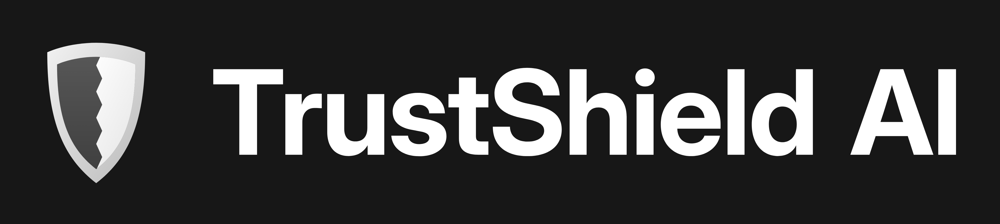

<p align="center">
  
</p>

<p align="center"><b>Detect. Verify. Stay safe.</b></p>

TrustShield AI checks a website address and tells you how risky it looks. Paste a URL and get a risk score, a plain-language explanation, and a breakdown of what was found: phishing signs in the address, the SSL certificate, the domain and DNS setup, web security settings, and reputation-database results.

**Live demo:** https://trust-shield-ai-iota.vercel.app

## Features

- **Phishing detection.** Analyzes the URL itself for suspicious keywords, misleading patterns, IP-based addresses, long URLs and odd subdomains.
- **SSL certificate analysis.** Checks HTTPS availability, certificate validity, issuer, expiry date, days remaining, TLS version and hostname match.
- **Domain and DNS analysis.** Registered domain and TLD (including `.co.in` and `.co.uk` style endings), subdomain count, domain age (RDAP, with WHOIS as a fallback), and NS, MX, TXT, CNAME, SPF and DMARC records.
- **Website security checks.** HTTP to HTTPS redirect and missing security headers, each with a short explanation of why it matters.
- **Threat intelligence.** Optional reputation checks with Google Safe Browsing and abuse.ch URLhaus, combined into one security assessment (verdict, safety score, grade, findings and recommendations).
- **Dashboard.** A responsive React interface (laptop and mobile) with a risk-score gauge, scan summary counters, SSL certificate details, domain analysis, a list of security issues, a risk overview, recent scan history, and a **Download Report** button.

## Preview

### Laptop

**Website security report and risk score**


**Security assessment and SSL certificate details**


### Mobile

<table>
  <tr>
    <td align="center">
      <br>
      <sub>Dashboard, scan box and risk score</sub>
    </td>
    <td align="center">
      <br>
      <sub>SSL, domain analysis, issues and report download</sub>
    </td>
  </tr>
</table>

## How it works

```
 React dashboard  --POST /scan-->  FastAPI backend
                                       |
        +------------------+-----------+-----------+--------------------+
        |                  |                       |                    |
  Phishing engine    SSL checker          Website security      Threat intelligence
  (URL analysis)     (certificate)    (domain, DNS, headers)   (reputation + verdict)
        |                  |                       |                    |
        +------------------+-----------+-----------+--------------------+
                                       |
                     One combined score (0 to 100) and explanation
```

Every analysis step is isolated. If one check fails or times out, the scan still returns a result from the others.

## Tech stack

| Area | Technology |
|---|---|
| Frontend | React (Vite), CSS, Chart.js |
| Backend | Python, FastAPI, Uvicorn |
| Validation | Pydantic |
| Security checks | Python standard library (`ssl`, `socket`, `http.client`) |
| Reputation sources | Google Safe Browsing, abuse.ch URLhaus (both optional) |
| Version control | Git, GitHub |

## Project structure

```
TrustShield-AI/
├── backend/
│   ├── main.py                    FastAPI app and /scan endpoint
│   ├── requirement.txt            Python dependencies
│   ├── security/
│   │   ├── phishing_engine.py     URL-based phishing detection
│   │   ├── ssl_checker.py         SSL certificate analysis
│   │   ├── website_security.py    Domain, DNS and web security analysis
│   │   └── threat_intel.py        Reputation checks and security assessment
│   └── tests/
│       ├── test_security.py       Offline unit tests
│       └── live_scan_test.py      End-to-end test against a running backend
├── frontend/
│   ├── public/                    Logo and README screenshots
│   └── src/
│       ├── App.jsx
│       ├── components/            Dashboard, Navbar, ScanResult, RiskChart, ScanHistory
│       └── services/
└── README.md
```

## Getting started

### Requirements

- [Python](https://www.python.org/downloads/) 3.10 or newer
- [Node.js](https://nodejs.org) (LTS version)
- [Git](https://git-scm.com/downloads)

### 1. Clone the project

```bash
git clone https://github.com/mayukhdeydhara17/TrustShield-AI.git
cd TrustShield-AI
```

### 2. Start the backend

Run these from the **project root** (the folder that contains `backend` and `frontend`).

```bash
python -m venv venv
venv\Scripts\activate            # Windows
# source venv/bin/activate       # macOS / Linux

pip install -r backend/requirement.txt
uvicorn backend.main:app --reload
```

The API runs at **http://127.0.0.1:8000**. Open **http://127.0.0.1:8000/docs** for the interactive API page.

### 3. Start the frontend

Open a **second terminal**:

```bash
cd frontend
npm install
npm run dev
```

Open **http://localhost:5173**. The top right of the page should say **Backend: Connected**.

### 4. Optional: enable reputation checks

The reputation checks need two free API keys. Without them everything else still works, and the verdict shows **UNVERIFIED** instead of **SAFE**, because a site is never called safe without checking a reputation database.

Create a file named `backend/.env`:

```
SAFE_BROWSING_API_KEY=your_google_safe_browsing_key
URLHAUS_AUTH_KEY=your_abuse_ch_auth_key
```

- **Google Safe Browsing:** create a project in the Google Cloud Console, enable the Safe Browsing API, and create an API key. It is free for non-commercial use.
- **URLhaus:** get a free Auth-Key from abuse.ch.

Never commit this file. It is listed in `backend/.gitignore`.

### Frontend configuration

If the frontend needs to point at a different backend address, create `frontend/.env`:

```
VITE_API_URL=http://127.0.0.1:8000
```

Restart `npm run dev` after changing it. For a deployed frontend, set `FRONTEND_URL` on the backend so the address is allowed by CORS.

## API

### `GET /health`

```json
{ "status": "healthy" }
```

### `POST /scan`

Request:

```json
{ "url": "https://example.com" }
```

Response (shortened):

```json
{
  "url": "https://example.com/",
  "risk_score": 12,
  "risk_level": "LOW",
  "phishing_detected": false,
  "ssl_valid": true,
  "ssl_details": { "status": "valid", "issuer": "…", "expires_on": "…", "days_remaining": 80 },
  "website_security": { "rating": "GOOD", "issues": [], "domain": {}, "dns": {} },
  "phishing_analysis": { "risk_score": 12, "reasons": [] },
  "reputation": { "flagged": false, "providers": [] },
  "security_assessment": { "verdict": "SAFE", "safety_score": 95, "grade": "A", "findings": [], "recommendations": [] },
  "security_status": "No major URL indicators",
  "explanation": "No suspicious URL indicators were detected."
}
```

`reputation` and `security_assessment` are included when the threat intelligence module is enabled.

**Risk levels:** `HIGH` is a score of 60 or more, `MEDIUM` is 30 to 59, and `LOW` is below 30. The score is capped at 100.

**Errors:** `400` for an invalid or blocked URL, `500` for an unexpected failure. The error message never exposes internal details.

## Safety rules for scanning

TrustShield AI makes network requests to addresses that users type in, so it protects itself:

- Only `http` and `https` URLs are accepted.
- URLs with embedded credentials, `localhost`, private or reserved IP addresses, and non-standard ports are rejected.
- The website security checks stop if a domain resolves to a non-public address.
- Every external request has a timeout and a bounded response size.
- API keys are read from environment variables or `backend/.env` and are never stored in the code.

**Privacy note:** reputation and domain checks send the scanned URL or domain to third-party services (Google Safe Browsing, abuse.ch, public DNS-over-HTTPS resolvers, and RDAP/WHOIS servers). Keep this in mind before scanning private addresses.

## Testing

Run from the project root with the virtual environment active.

Offline unit tests (no internet needed):

```bash
python -m unittest backend.tests.test_security -v
```

End-to-end test (the backend must be running, and internet is needed):

```bash
python backend/tests/live_scan_test.py
```

It scans a valid site, expired and wrong-host certificates, plain HTTP, an IP address, a domain that does not exist, and blocked inputs, then prints a PASS/FAIL table.

## Troubleshooting

| Problem | Fix |
|---|---|
| Page says **Backend: Disconnected** | Start the backend first, check that `http://127.0.0.1:8000/health` opens, then hard refresh with `Ctrl + Shift + R` |
| `Could not import module "main"` | Run `uvicorn backend.main:app --reload` from the project root, not from inside `backend` |
| `No module named backend…` | Run commands from the project root with the virtual environment active |
| `npm` is blocked in PowerShell | Run `Set-ExecutionPolicy -Scope CurrentUser RemoteSigned` once, or use `npm.cmd` |
| `Could not read package.json` | Run `npm` commands inside the `frontend` folder |
| Verdict shows `UNVERIFIED` | No reputation API keys are set (see step 4 above) |

## Contributing

1. Create your own branch from the latest `main`:
   ```bash
   git checkout main
   git pull
   git checkout -b your-branch-name
   ```
2. Commit only the files you changed (avoid `git add .`, so `venv`, `node_modules` and `.env` are never uploaded).
3. Push the branch and open a pull request into `main`.
4. Wait for a teammate or the team lead to review and merge.

## Team

| Member | Area |
|---|---|
| Mayukh Dey Dhara | Phishing detection engine (URL analysis, phishing intelligence) |
| Neevv Khillan | SSL, website security and threat intelligence |
| Lakshya Jha | Frontend, dashboard and integration |

## Roadmap

- [x] FastAPI backend with `/health` and `/scan`
- [x] URL-based phishing analysis
- [x] SSL, domain, DNS and web security analysis
- [x] Reputation checks and security assessment
- [x] Show the detailed security assessment in the dashboard
- [x] Downloadable scan report
- [x] Final testing, documentation and demo
